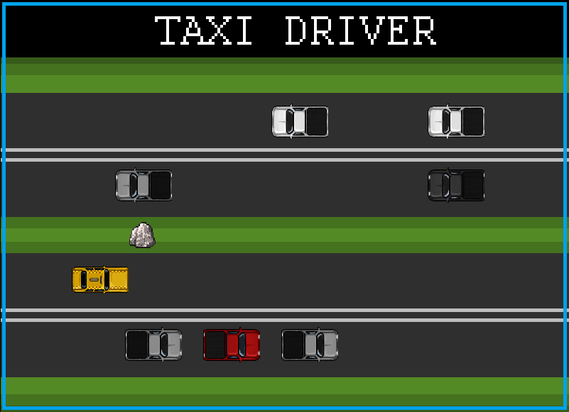

# PRIMER PARCIAL DE PROGRAMACIÓN I

# I. FUNDAMENTACIÓN:
Este proyecto integra los contenidos vistos en las materias de Programación 1 y Laboratorio 1 de la Tecnicatura en Programación de la UTN:

1. Sintaxis: Escritura y organización del código en Python.
2. Variables y tipos de datos: Uso de números, textos, listas, tuplas y diccionarios para guardar información.
3. Estructuras de control: Uso de condiciones y bucles para controlar el funcionamiento del juego.
4. Funciones: Creación de bloques de código que permiten organizar y reutilizar instrucciones.
5. Eventos: Detección de las acciones del jugador, como por ejemplo, apretar botones.
6. Bibliotecas y módulos: Uso de herramientas externas y archivos propios para organizar más el código.
7. Manejo de errores: Control de situaciones, como por ejemplo, la detección de la ausencia del archivo de guardado.
8. Archivos: Lectura y escritura de datos para guardar la puntuación máxima.
9. Movimiento y colisiones: Control del movimiento de los vehículos y detección de impactos/choques con otros objetos.
10. Elementos aleatorios: Selección al azar de vehículos y detección de choques con otros objetos.
12. Utilización de Pygame: Creación de la interfaz gráfica, movimiento de objetos, reproducción de sonidos y control de los eventos del juego.

# II. DESCRIPCIÓN GENERAL DEL PROYECTO:
El proyecto se basa en un juego de estilo arcade llamado "Taxi Driver", este esta desarrollado en Python con la biblioteca Pygame. El objetivo del juego es manejar un vehículo, esquivar piedras y otros vehículos, y moverlo hacia arriba o abajo utilizando las teclas W y S. También se puede acelerar apretando la letra D.

El juego consta de las siguientes características: 

1. Pantalla de inicio: Incluye botones para comenzar a jugar, entrar a las opciones o salir del juego.
2. Jugador: Permite manejar un vehículo y moverlo hacia arriba o abajo apretando las teclas W y S. También se puede acelerar con la letra D.
3. Objetos y vehículos: Aparecen otros vehículos que circulan en distintas direcciones y piedras que el jugador tiene que esquivar.
4. Sistema de puntuación: Permite acumular puntos al acelerar y circular en contramano.
5. Bonificaciones: El juego incluye relojes que permiten sumar diez segundos al tiempo disponible.
6. Sistema de tiempo: Cada partida comienza con 30 segundos, que pueden aumentarse al recoger relojes.
7. Sistema de vidas: El jugador comienza con tres vidas y pierde una al chocar contra un vehículo o una piedra.
8. Récord personal: El juego guarda la máxima puntuación en un archivo .txt para conservarla entre partidas.
9. Sistema de pausa: El juego permite detener temporalmente la partida y continuarla cuando el jugador quiera.
10. Menú de opciones: El juego permite activar o desactivar el volumen.
11. Gráficos y sonidos: El juego incorpora imágenes, fondos, textos personalizados, música y efectos de sonido.
12. Pantalla de Game Over: Al perder una vida, permite al jugador volver a jugar. Cuando se agotan las tres vidas, muestra la puntuación final y el récord alcanzado.
13. Distintos mapas: El juego tiene distintos mapas con los que podes interactuar en distintas partidas.

# III. CONSIDERACIONES:
Este proyecto es de mi autoría, pero la aplicación de conceptos se da en base a los conocimientos vistos en las clases de Programación 1 y Laboratorio 1, gracias a los profesores de dichas materias. El código del juego es de mi producción, en cambio los sprites y los sonidos del juego se consiguieron de manera gratuita a través de internet. 

## GAMEPLAY DEL JUEGO:
[Gameplay del juego](https://youtu.be/w7a32JV3Uhc?si=NdOOUMmHIGD38rqS)
